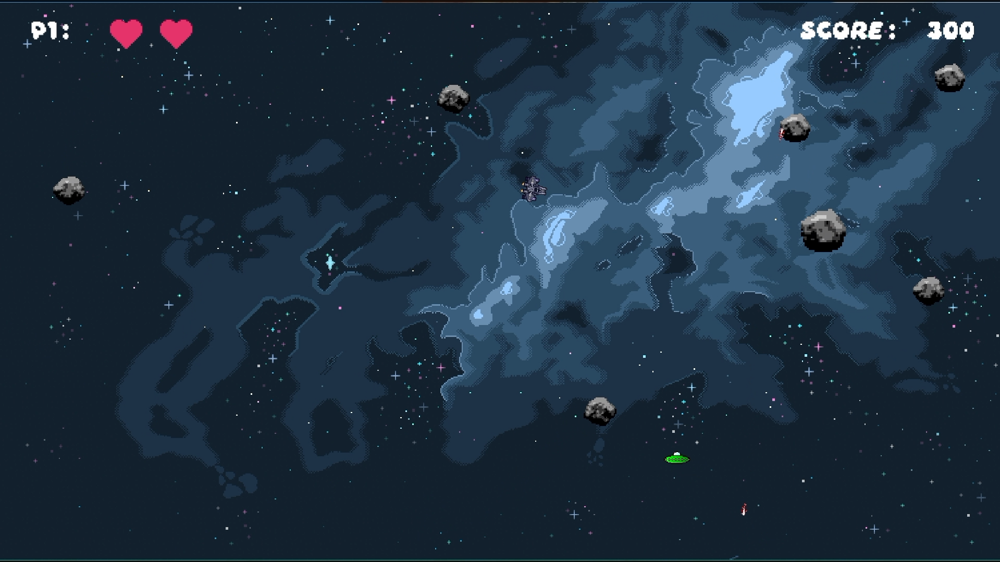
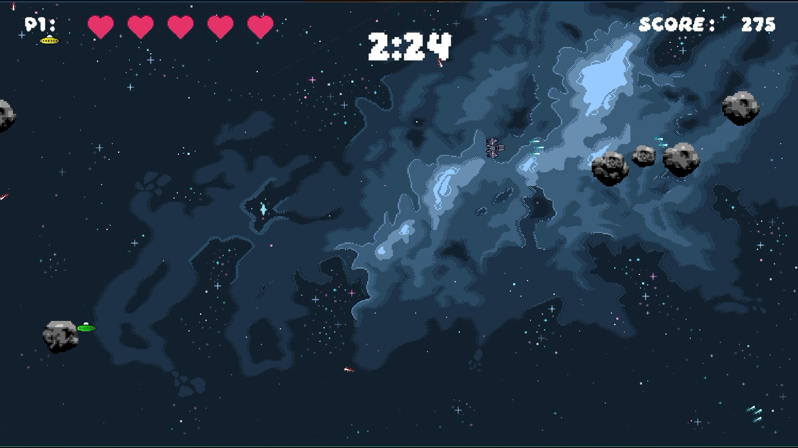
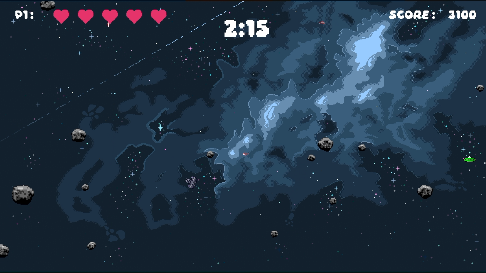
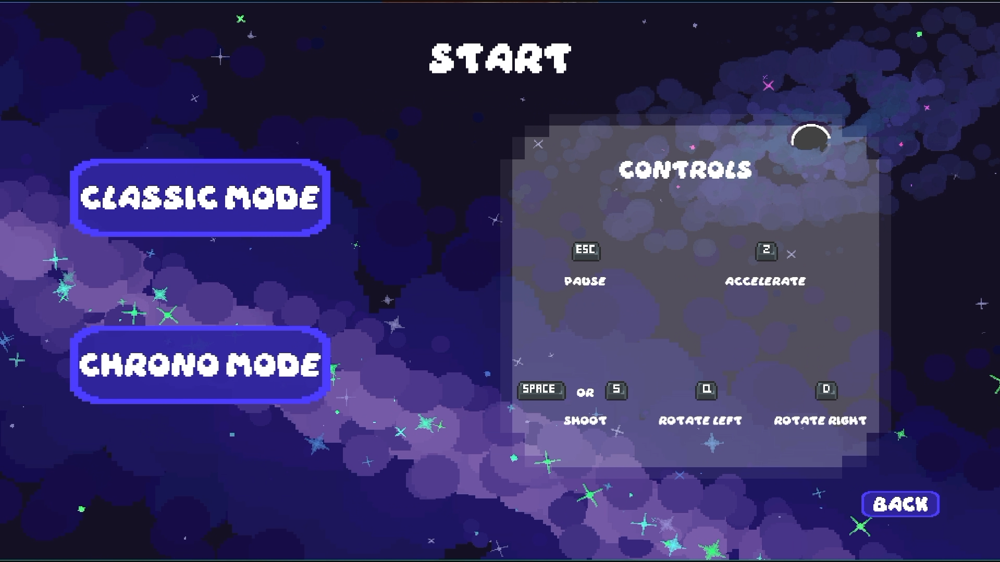
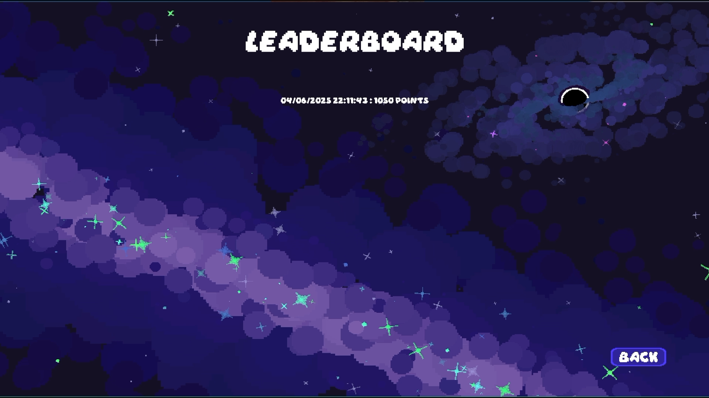

# ASTEROIDS

**A retro-inspired space shooter built with C++ and SFML 3.**

Destroy asteroids. Dodge enemy ships. Beat your high score.

[**Download on itch.io**](https://sachachaussette.itch.io/asteroids) · [**Latest GitHub release**](https://github.com/SachaGastinois/Asteroids/releases/latest)

 

## About the game

**Asteroids** is a 2D arcade shooter inspired by the original arcade classic. Pilot a spaceship through a field of asteroids and hostile UFOs, dodge incoming projectiles, and try to survive long enough to set a new record.

The game was developed in **C++ with SFML 3**, on top of a **custom 2D game engine** built for the project.

## Game modes

| Classic Mode | Chrono Mode |
|:--|:--|
| Survive waves of asteroids and UFOs. After each wave, choose between improving your weapons or gaining an extra life. The difficulty increases as you progress. | Score as many points as possible before the **2 minute 30 second** timer runs out. Keep moving, keep shooting, and make every second count. |

## Screenshots

  
  
  
  

## Controls

The default key bindings use an **AZERTY keyboard layout**.

| Key | Action |
|:--|:--|
| `Z` | Accelerate |
| `Q` / `D` | Turn left / right |
| `Space` or `S` | Shoot |
| `Esc` | Pause |

## Features

- Two distinct arcade modes: **Classic** and **Chrono**
- Increasing enemy waves and selectable upgrades in Classic Mode
- Asteroids, UFOs, projectiles and collision handling
- Player health, scoring and a leaderboard
- Pixel-art-inspired visuals, animations, music and sound effects
- Menu, pause and game-over interfaces

## Under the hood

The game uses a custom C++ engine with systems for:

- **Actors and components** — entities, player movement, shooting and health
- **Level and game-mode management** — menus and gameplay scenes
- **Collision and input management** — interactions and keyboard actions
- **Rendering and animation** — sprites, textures, cameras and UI widgets
- **Audio and resources** — sound playback, music, fonts and asset loading

The project uses **C++** and **SFML 3.0.0**. Engine and gameplay source code are included in this repository.

## Download & play

The easiest way to play is to download the Windows build from **[itch.io](https://sachachaussette.itch.io/asteroids)** or **[GitHub Releases](https://github.com/SachaGastinois/Asteroids/releases/latest)** (when a release is available).

1. Download the Windows ZIP.
2. Extract the entire folder.
3. Launch `Engine.exe` — keep the `Assets` folder and required DLLs alongside the executable.

> **Windows:** The distributable build is intended for Windows x64. This is a desktop game, not a browser build.

## Build from source

To build the project yourself:

1. Install **Visual Studio 2022** with the **Desktop development with C++** workload.
2. Download **SFML 3.0.0** for your compiler and architecture.
3. Place the SFML directory alongside the cloned repository, named `SFML-3.0.0`, so that `..\SFML-3.0.0\include` and `..\SFML-3.0.0\lib` are valid from the project directory.
4. Open `Engine.sln` and select **Release | x64**.
5. Build the solution. Copy `Assets` next to the resulting executable before running it outside the IDE.

> The Visual Studio project currently uses a relative SFML path. You may need to adjust the include, library or DLL paths for your local setup.

---

Developed by **Sacha Gastinois**  
[Play on itch.io](https://sachachaussette.itch.io/asteroids) · [Browse the source](https://github.com/SachaGastinois/Asteroids)

